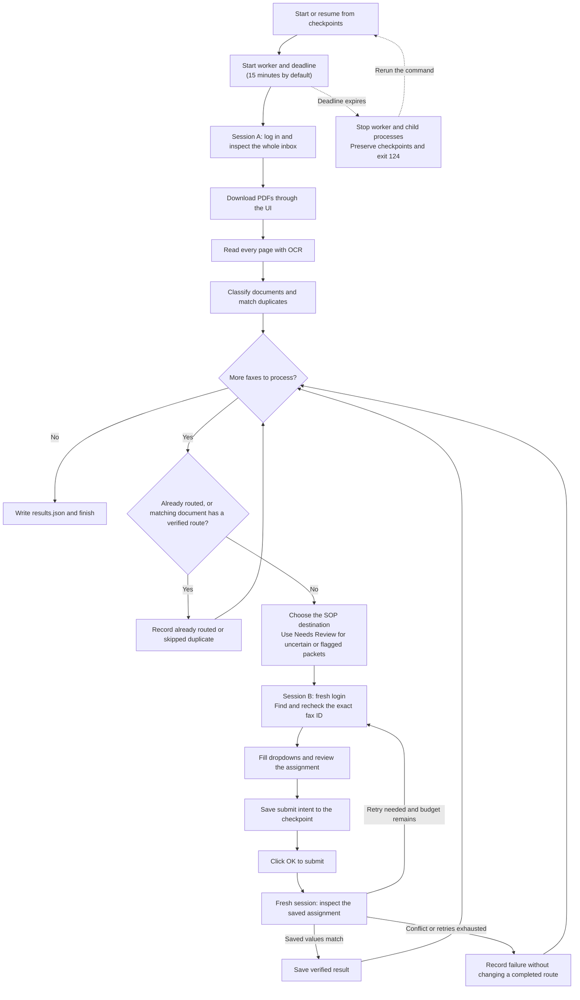

# Engineering notes

The main thing I wanted to get right was recovery.
A download can fail, a login can expire, or the portal can save an assignment and then return a 503.

I used a deterministic workflow with local OCR and explicit routing rules.
The main flow is in `worker.py`, browser interactions are in `portal.py`, and classification and duplicate matching are in `policy.py`.

## Workflow

A submit only counts as successful after the worker checks the saved assignment in the UI.

## Read the queue before routing

The inbox is newest-first, so the worker collects and reads the whole queue before submitting routes.
That gives it enough context to find an earlier original when a resend shows up first.
Every page is included in the extraction, including cover sheets and supporting pages.
Byte-identical PDFs can reuse saved OCR on a later run.

Classification comes from recognized headings and the packet evidence.
Urgent or critical flags, mixed categories, unreadable pages, missing continuation pages, and unclear classifications go to Needs Review with a reason in the note.
The worker does not interpret clinical results or fill in missing identifiers.

## Match documents across fax IDs

A confirmed duplicate needs a reliable source ID plus matching patient name, date of birth, and document category.
If no matching fax has been routed, the earliest unambiguous transmission gets processed first.

An existing UI-verified completed route takes precedence over receipt order.
For example, if a later resend is already Routed while the earlier original is still New, the New copy is skipped and linked to that completed fax.
This prevents another assignment for the same document.
Uncertain matches go to manual review.

## Check the UI and save intent

The download happens in one authenticated browser context.
Routing uses a fresh context created afterward, with another login and an exact fax-ID match.
The worker checks the confirmation dialog, saves the intended assignment, and then presses OK.
A fresh context checks all three saved routing fields afterward.
A conflicting completed assignment is reported and left untouched.

Before a retry or on a later run, the worker reads the current UI state.
An expected saved assignment is accepted without another submit.
A fresh read showing New allows a retry within the budget.
An unavailable UI leaves the outcome unresolved.

Checkpoints live in the worker's own SQLite database, separate from the portal database.
There is one record per fax ID, with transactions, WAL, and FULL synchronization.
A file lock keeps two workers out of the same state directory, and JSON exports use a flushed temporary file with atomic replacement.

## Failure handling

| Case | What happens |
|---|---|
| Temporary download failure | Log in through a fresh context, find the fax again, and retry |
| HTML attachment or broken PDF | Reject it before OCR and retry |
| Expired routing session | Log in again and inspect saved state before another attempt |
| Submit commits but returns 503 | Read the saved assignment through the UI |
| Process stops around OK | Reconcile the saved intent with the UI on resume |
| Readable packet with uncertain classification | Route to Needs Review with the reason |
| Ingestion still fails after retries | Hold unrouted work because duplicate checking is incomplete |
| Whole-run deadline expires | Stop the processing tree, export a timeout snapshot, and exit `124` |

## Put the deadline outside the work

If the worker gets stuck, a separate supervisor stops it after 15 minutes and closes its browser and OCR processes.
Saved progress is kept, so the next run can check what happened in the portal before trying again.
The timeout report shows the last saved progress.

## Tradeoffs and limits

Local Tesseract worked well on the supplied scans and keeps runtime costs down.
The classifier targets the printed English headings in the SOP.
Handwriting, unfamiliar layouts, and other languages can need manual review.
OCR confidence measures text recognition quality; classification still depends on the evidence and routing rules.

If a fax still can’t be downloaded or read after retries, the worker holds the remaining faxes.
This delays some work, but avoids accidentally routing the same document twice.

Run one worker at a time and keep the same progress folder so it can track previous work.
Faxes arriving after the initial inbox check are handled on the next run.
The worker matches faxes across sessions using their IDs and visible details,
but the portal doesn’t provide a way to confirm whether the document itself has changed.

PDFs are limited to 25 MiB and 100 pages, and discovery is limited to 1,000 inbox pages.
Each OCR pass has a 30-second timeout, with up to five passes and a 16-million-pixel render cap per page.
Unsupported inputs fail explicitly.
